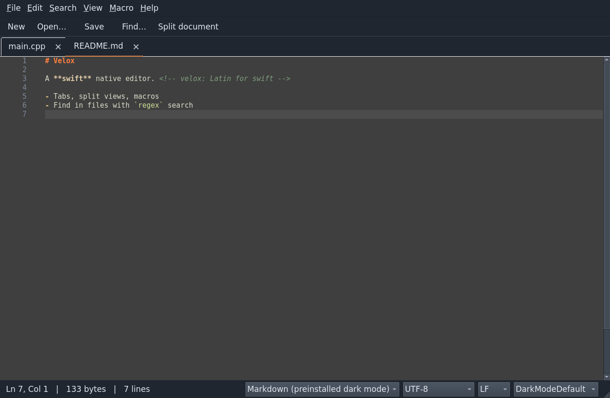
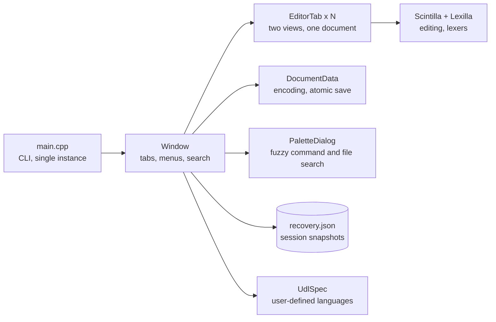

<h1 align="center">Velox</h1>

<p align="center">A fast, lightweight native text and code editor for Linux.</p>

<p align="center">
  <a href="https://github.com/DakodaStemen/velox/actions/workflows/ci.yml"></a>
</p>



> [!NOTE]
> Velox is a single self-contained binary built on Qt and [Scintilla](https://www.scintilla.org/). It starts in about a third of a second and opens a 100 MiB file in a few seconds; see [Performance](#performance) for how that was measured.

## Features

- **Tabs and split views.** Two views of the same document, drag and drop, recent files, a folder sidebar and a document outline.
- **Syntax highlighting** for about 95 languages, 22 color themes, keyword completion and code folding.
- **User-defined languages.** Define one in Language → Define custom language (keywords, comments, strings, operators and colors), or describe it in a UDL 2.x XML file. Markdown definitions are included.
- **Search.** Regular expression find and replace with captures and zero-width matches (`^`, `$`, lookarounds), *Mark all*, and *Find in files* with a clickable results panel.
- **Careful file handling.** UTF-8 (with or without BOM), UTF-16 and UTF-32 (LE/BE) and legacy code pages. Saves are atomic, refuse to lose characters or overwrite files changed by other programs, and preserve permission bits and symlinks (hard-linked files are refused; use Save As). Saves replace the file by atomic rename, so ownership, ACLs and extended attributes are not preserved.
- **Editing power.** Multiple cursors, rectangular selection (Alt+drag), line ending conversion, bookmarks, macro recording and playback, comment toggling, line sorting, de-duplication, joining and moving.
- **Large files.** Files up to 1 GiB open; above 32 MiB highlighting, folding and the outline are switched off to stay responsive.
- **Preferences.** Font, tab width, spaces or tabs, line numbers, wrapping, and optional trailing-whitespace trimming and final newline on save (Edit → Preferences).
- **Never lose work.** Unsaved text is snapshotted every few seconds and restored after a crash. Changes made to open files by other programs are detected.
- **One window.** Running `velox file.txt` while Velox is open adds a tab to the existing window.

## At a glance

| Area | What you get |
| --- | --- |
| Languages | About 95 syntax-highlighted languages, 22 themes, user-defined languages (UDL 2.x XML) |
| Navigation | Command palette (Ctrl+Shift+P), quick open (Ctrl+P), outline, folder sidebar, bookmarks |
| Search | Boost.Regex find and replace, mark all, find in files |
| Safety | Atomic saves, external-change detection, crash recovery snapshots |
| Files | UTF-8/16/32, legacy code pages, files up to 1 GiB |

## Installation

### Arch Linux

```sh
git clone https://github.com/DakodaStemen/velox.git
cd velox/packaging
makepkg -si
```

The package installs a single self-contained binary, desktop entry, icon and AppStream metadata.
To make Velox the default editor for plain text:

```sh
xdg-mime default io.github.DakodaStemen.Velox.desktop text/plain
```

### Other distributions

Install Qt 5.15 or Qt 6 (Widgets, XML, Network, SVG, plus Core5Compat on Qt 6; Test unless built with `SELFTEST=0`), a C++17 compiler and `make`, then:

```sh
./build.sh                                 # Qt 5; use QT=6 ./build.sh for Qt 6
sudo make -C build/app install          # installs to /usr; set PREFIX=... when running build.sh to change it
```

## Usage

```
velox [options] [files…]

  FILE:LINE[:COLUMN]  open a file with the cursor at a position
  --new-instance   open a separate window instead of reusing a running one
  --fresh          start without restoring the previous session
  --self-test      run the integration test suite (development builds only, see below)
  --version, --help
```

| Shortcut | Action |
| --- | --- |
| Ctrl+F / Ctrl+H | Find / Replace |
| Ctrl+Shift+F | Find in files |
| F3 / Shift+F3 | Next / previous match |
| Ctrl+G | Go to line |
| Ctrl+F2, F2 | Toggle bookmark, next bookmark |
| Ctrl+D | Duplicate line or selection |
| Ctrl+Alt+S | Split view |
| Ctrl+Shift+P / Ctrl+P | Command palette / quick open (fuzzy file search in the sidebar folder) |
| Ctrl+Shift+R / Ctrl+Alt+P | Record / play macro (editor actions only; menu commands are not recorded) |
| Alt+Z | Toggle word wrap |
| Ctrl+/ | Toggle comment |
| Alt+Up / Alt+Down | Move line up / down |
| Ctrl+J | Join lines |
| Ctrl+, | Preferences |

## How it fits together



More detail in [docs/architecture.md](docs/architecture.md).

> [!TIP]
> Not sure where a command lives? Press Ctrl+Shift+P and type a few letters of its name.

## Configuration

| What | Location |
| --- | --- |
| Settings | `~/.config/velox/settings.ini` |
| Your user-defined languages | `~/.config/velox/userDefineLangs/*.xml` |
| Crash recovery snapshot | `~/.local/share/velox/recovery.json` (`recovery-<pid>.json` for `--new-instance` windows) |
| Bundled languages and themes | `/usr/share/velox` (override with `VELOX_DATA_DIR`) |

**Help → Open configuration folder** creates and opens the configuration directory.

## Building from source

```sh
./build.sh                                 # Scintilla, Lexilla and the application (QT=6 for Qt 6)
SANITIZE=1 ./build.sh                      # with AddressSanitizer and UBSan, for testing
./run.sh [files…]                          # run from the build tree
QT_QPA_PLATFORM=offscreen ./run.sh --self-test
```

`build.sh` compiles the test suite in (`CONFIG+=selftest`) so `--self-test` works. Release and
packaging builds leave it out, which also drops the Qt Test dependency:

```sh
SELFTEST=0 ./build.sh                      # production binary, no --self-test
PREFIX=/usr SELFTEST=0 ./build.sh && make -C build/app INSTALL_ROOT="$PWD/pkg" install
SANITIZE=1 ./build.sh                      # ASan + UBSan build (CONFIG+=sanitizer)
```

The version lives in one place, `VERSION` in `velox.pro`; `scripts/check-version.sh` verifies the
PKGBUILD, AppStream metadata and CHANGELOG agree with it.

See [docs/architecture.md](docs/architecture.md) for a tour of the code.

## Performance

> [!IMPORTANT]
> Numbers below come from one run of `scripts/bench.sh 10` on a busy development machine (headless Qt `offscreen` platform, warm page cache, Qt 5 build with the self-test suite compiled in). Treat them as a baseline for comparing changes, not as a ranking against other editors. Run the script yourself for your own hardware.

| Metric | Median | Range (n=10) |
| --- | ---: | ---: |
| Start to ready, empty window | 327 ms | 277–446 ms |
| Start to ready, 100 MiB file open | 3364 ms | 2364–3865 ms |
| RSS, empty window | 49 MiB (peak 49) | single sample |
| RSS, 100 MiB file open | 457 MiB (peak 457) | single sample |

Hardware: AMD Ryzen 7 5800H with Radeon Graphics, 16 threads, 14 GiB RAM, load average 28.76 32.81 56.16, Linux 7.0.0-38-generic.

**Method.** Each timing launches `velox --new-instance --fresh --screenshot` as a new process, which renders the window after a fixed 700 ms and exits; that constant is subtracted, so the figure covers process start, opening any files and the first render. Memory is `VmRSS` read from `/proc` six seconds after launch. The 100 MiB file is generated ASCII text (about 1.3 million lines); above 32 MiB highlighting, folding and the outline are off.

## Roadmap

- Make Qt 6 the default (it builds with `QT=6 ./build.sh` and has a CI job; Qt 5 remains supported)
- Flatpak package (a manifest is in `packaging/`; it parses but has not been built yet)
- AppImage on releases (the release workflow builds one; untested until the first tag)
- Plugin API

## Contributing

> [!WARNING]
> Do not include real file contents or personal paths in bug reports or crash logs unless you are comfortable sharing them.

Bug reports, ideas and pull requests are welcome. Please read [CONTRIBUTING.md](CONTRIBUTING.md) and
the [Code of Conduct](CODE_OF_CONDUCT.md). Security issues: see [SECURITY.md](SECURITY.md).

## License

Velox is free software, released under the [GNU General Public License v3.0 or later](LICENSE).
It bundles third-party components under their own licenses; see
[THIRD_PARTY_NOTICES.md](THIRD_PARTY_NOTICES.md).
